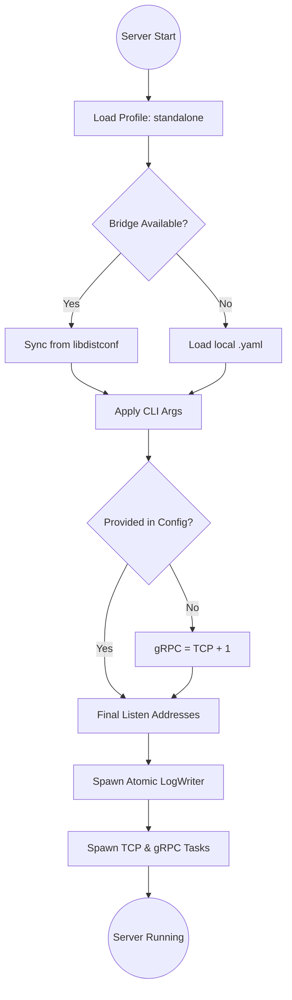

# Log Server Architecture

This document describes the data flow and component hierarchy of the Log Server.

## Data Flow Overview

- **TCP Entry [HARDENED]**: High-performance Cap'n Proto stream requiring a 4-byte BE length prefix and a mandatory Identity Handshake.
- **gRPC Log Bridge**: Interoperability gateway for HTTP/JS clients (Port 9021).
- **Unified Processing**: Both ingestion paths converge into a shared asynchronous pipeline for sequencing and persistent storage.

## Bootstrapping State Machine



## Component Diagram

```text
                        *Optional gRPC support
┌──────────────────┐    ┌──────────────────┐
│   TCP Clients    │    │ Log Bridge (JS)  │
│  ┌─────────────┐ │    │  ┌─────────────┐ │
│  │ App Layer   │ │    │  │ App Layer   │ │
│  └──────┬──────┘ │    │  └──────┬──────┘ │
│  ┌──────▼──────┐ │    │  ┌──────▼──────┐ │
│  │  TcpServer  │ │    │  │BridgeGateway│ │
│  └──────┬──────┘ │    │  └──────┬──────┘ │
│  ┌──────▼──────┐ │    │  ┌──────▼──────┐ │
│  │  SafeSocket  │ │    │  │ gRPC Channel│ │
│  └──────┬──────┘ │    │  └──────┬──────┘ │
└─────────┼────────┘    └─────────┼────────┘
          │                       │
          ▼                       ▼
    ┌─────────────────────────────┐
    │     Protocol Handlers       │
    │  -------------------------- │
    │  (Cap'n Proto / Protobuf)   │
    └──────────────┬──────────────┘
                   │
                   ▼
    ┌─────────────────────────────┐
    │       LogEntry Model        │
    │  -------------------------- │
    │  (Unified Internal Format)  │
    └──────────────┬──────────────┘
                   │
                   ▼
    ┌─────────────────────────────┐
    │     MPSC FIFO Channel       │
    │  -------------------------- │
    │  (Guarantees Arrival Order) │
    └──────────────┬──────────────┘
                   │
                   ▼
    ┌─────────────────────────────┐
    │         LogWriter           │
    │ ┌─────────────────────────┐ │
    │ │ Single-Authority FIFO   │ │
    │ └────────────┬────────────┘ │
    │ ┌─────────────────────────┐ │
    │ │ Dynamic Burst Draining  │ │
    │ └────────────┬────────────┘ │
    │ ┌─────────────────────────┐ │
    │ │ TransactionalFileWriter │ │
    │ └────────────┬────────────┘ │
    └──────────────┼──────────────┘
                   │
                   ▼
    ┌─────────────────────────────┐
    │        File System          │
    │  (logs/_main.log + backups) │
    └─────────────────────────────┘
```

## Key Architectural Decisions

### 1. Sequencing & Ordering
`LogWriter::writer_task` acts as the single sequence authority upon dequeue from the MPSC channel. This eliminates pre-channel atomic race conditions and out-of-order reorder stalls, assigning monotonic sequence IDs and draining bursts via `rx.try_recv()` to ensure exact FIFO durability.

### 2. Protocol Agnosticism
The `Protocol Handlers` act as a bridge, converting protocol-specific data (Cap'n Proto or gRPC) into our internal `LogEntry` struct. This decoupling allows us to add new input protocols by simply implementing a new handler.

### 3. High-Performance Disk I/O
The `LogWriter` implements **Dynamic Batching**. It automatically scales the batch size up to 1000 messages during high load to minimize syscalls, and scales down to 10 messages during idle periods to maintain real-time responsiveness.

### 4. Robustness & Hardening
- **Protocol Security**: `TcpServer` enforces a mandatory Handshake immediately upon connection. Anonymous or un-framed data results in immediate disconnection.
- **Transactional Disk Recovery**: Disk writes use `TransactionalFileWriter` with in-memory staging, POSIX `ftruncate` rollback on partial writes, and poisoned descriptor recovery.
- **Fail-Fast Supervision**: Fatal disk failures push `[DISK_FAILURE]` `CRITICAL` (level 11) to `LogRingBuffer` and terminate with exit code 1, triggering `watchdog-agent`'s circuit breaker and Telegram alerts.
- **Strict Framing**: `SafeSocket` enforces `MAX_MESSAGE_SIZE` (10MB) and handles unexpected EOFs cleanly.

### 5. Persistent Error Log Shipping (TimescaleDB Hypertable)
While raw debug and info streams are handled high-speed in memory ring buffers and local append-only log files by `log-server`, critical operational events (`level >= ERROR`) are autonomously extracted and persisted in a TimescaleDB hypertable (`fleet_error_logs`).
- **Shipper Subsystem**: Embedded within `watchdog-agent/src/shipper/` (or run as dedicated `log-shipper` in Docker).
- **Decoupled Architecture**: Log producers simply write to their local log files without synchronous database network overhead. The shipper handles batch ingestion, cursor checkpointing, and retry on database downtime.
- See detailed standard: [[16-Fleet-Error-Log-Persistence-Standard.md]].
