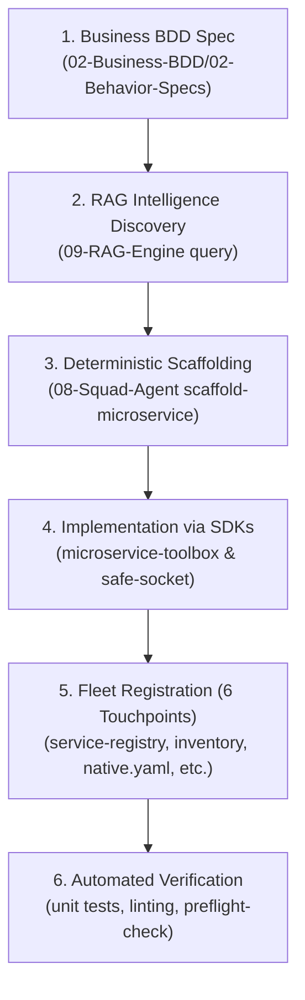

# 🏛️ Microservice Integration Standard Blueprint

This document defines the authoritative, mandatory blueprint for building, bootstrapping, and maintaining microservices across the Bastien-Antigravity ecosystem. It serves as both human operational guidance and an AI agent integration prompt.

---

## 1. Ecosystem Topology & Base Repositories

The core ecosystem (`Bastien-Antigravity-base`) consists of 14 foundational repositories:

| Repository | Responsibility | Key Language |
| :--- | :--- | :--- |
| `distributed-config` | Core distributed config engine (`libdistconf`, CGO bridge) | Go / CGO |
| `config-server` | Central configuration server daemon & REST/gRPC distributor | Go |
| `universal-logger` | Standardized multi-sink logging abstraction (`Logger`) | Go / Python / Rust |
| `flexible-logger` | Legacy/extended logging engine and adapters | Go |
| `log-server` | High-throughput centralized log streaming daemon | Rust |
| `safe-socket` | High-reliability framed TCP transport library | Go / Rust / Python |
| `microservice-toolbox` | Universal cross-language bootstrap, config, contracts, and lifecycle facade | Go / Python / Rust / C/C++ |
| `notif-server` | Multi-channel dispatch engine (Telegram, Discord, Webhooks) | Go |
| `tele-remote` | Remote C2 & telemetry bridge for Telegram bot interfaces | Go |
| `web-interface` | Central monitoring dashboard & OpenMFE host | Go / TypeScript / JS |
| `watchdog-agent` | Process supervisor, health checker, and config symlink healer | Go |
| `docker-deployment` | Containerization, environment profiles, and native templates | Docker / Shell |
| `sandbox-testing` | Integration test harnesses and sandbox runners | Go / Shell |
| `obsidian-brain` | Central documentation vault, architecture records, and RAG Engine | Markdown / Python |

---

## 2. Universal Bootstrap Ritual

All microservices regardless of language **MUST** bootstrap via `microservice-toolbox`. Direct ad-hoc parsing of YAML, direct environment variable lookups without fallback chains, or raw flag parsing is strictly prohibited.

### Go Lifecycle Pattern:
```go
package main

import (
    "os"
    toolbox_bootstrap "github.com/Bastien-Antigravity/microservice-toolbox/go/pkg/bootstrap"
    toolbox_lifecycle "github.com/Bastien-Antigravity/microservice-toolbox/go/pkg/lifecycle"
    toolbox_spec "github.com/Bastien-Antigravity/microservice-toolbox/go/pkg/spec"
)

func main() {
    // 1. Initialize configuration and logger in a single call (auto-wires WireTap)
    appConfig, log := toolbox_bootstrap.BootstrapService("my-service")
    defer log.Close()

    log.Info("Starting my-service (version %s) under profile: %s", appConfig.GetVersion(), appConfig.Profile)

    // 2. Setup lifecycle manager & register ServiceSpec + Exchange Contracts
    lm := toolbox_lifecycle.NewManagerWithLogger(log)
    _ = toolbox_spec.PublishWithLifecycle(appConfig, log, lm, "my_capability", toolbox_spec.ServiceSpec{
        Name: "My Service", Tag: "my-service-mfe", Layer: "L2", Category: "Domain Services",
        Description: "...", DocLink: "obsidian-brain/06-Microservices/my-service.md",
        Protocol: "TCP / REST", Framing: "Port %s TCP / Port %s REST",
    })

    // 2. Extract typed capabilities
    var cap MyCapability
    if err := appConfig.Config.GetCapability("my_capability", &cap); err != nil {
        log.Critical("Failed to load required capability: %v", err)
        os.Exit(1)
    }

    // 3. Decrypt sensitive secrets on demand
    decryptedPassword, err := appConfig.DecryptSecret(cap.Password)
    if err != nil {
        log.Critical("Failed to decrypt secret: %v", err)
        os.Exit(1)
    }

    // 4. Setup graceful lifecycle termination
    ctx := toolbox_lifecycle.SignalContext()
    <-ctx.Done()
    log.Info("Shutting down gracefully...")
}
```

### Python Lifecycle Pattern (`init_microservice` + `spec` + `contracts` + `WireTap`):
```python
from microservice_toolbox.contracts import ExchangeContract, build_contracts_envelope, extract_fastapi_operations
from microservice_toolbox.spec import ServiceSpec, publish_with_lifecycle
from microservice_toolbox.utils.init import init_microservice

app_config, logger, lm = init_microservice(__file__, app_name="my_service")
version = app_config.get_version()  # Dedicated AppConfig method (VERSION.txt only)
db_cap = app_config.get_capability("timescale_db")
decrypted_pass = app_config.decrypt_secret(db_cap["password"])

# Build Exchange Contracts with built-in extractors & register via spec
contracts = [ExchangeContract(id="rest", type="HTTP/1.1 REST", operations=extract_fastapi_operations(app))]
publish_with_lifecycle(
    app_config, logger, lm, "my_service",
    spec=ServiceSpec(name="My Service", tag="my-service-mfe", layer="L2", category="Domain Services",
                     description="...", doc_link="obsidian-brain/06-Microservices/my-service.md",
                     protocol="HTTP/1.1 REST", framing="Port %s REST", contracts=contracts),
)
```

### Rust Lifecycle Pattern (`AppConfig` + `LifecycleManager` + `spec` + `contracts`):
```rust
use microservice_toolbox::config::AppConfig;
use microservice_toolbox::lifecycle::LifecycleManager;
use microservice_toolbox::spec::{publish_with_lifecycle, ServiceSpec};

fn main() -> Result<(), Box<dyn std::error::Error>> {
    let app_config = AppConfig::load_config("standalone", None)?;
    let version = app_config.get_version(); // Dedicated AppConfig method (VERSION.txt only)
    let lm = LifecycleManager::new();
    // Build ExchangeContracts via microservice_toolbox::contracts and register via publish_with_lifecycle
    let _ = (version, &lm, publish_with_lifecycle);
    Ok(())
}
```

### C++17 Lifecycle Pattern (`AppConfig` + `LifecycleManager` + `SpecPublisher` + `contracts`):
```cpp
#include "microservice_toolbox/config/AppConfig.hpp"
#include "microservice_toolbox/lifecycle/LifecycleManager.hpp"
#include "microservice_toolbox/spec/spec.hpp"
#include "microservice_toolbox/spec/contracts.hpp"

int main(int argc, char** argv) {
    auto appConfig = microservice_toolbox::config::LoadConfig("standalone", argc, argv);
    std::string version = appConfig->GetVersion(); // Dedicated AppConfig method (VERSION.txt only)
    microservice_toolbox::lifecycle::LifecycleManager lm;
    microservice_toolbox::spec::ServiceSpec spec;
    // Populate metadata + contracts (auto-enriches URL, Framing %s ports, version, node, health)
    microservice_toolbox::spec::SpecPublisher::PublishWithLifecycle(
        *appConfig, appConfig->GetLogger(), &lm, "my_service", spec);
    lm.Wait();
    return 0;
}
```

---

## 3. Configuration & Symlink Architecture

### Single Source of Truth (`native.yaml`)
- The ecosystem stores the canonical native profile in:
  `docker-deployment/modes/local/config/native.yaml`
- Every microservice repository must provide a relative symbolic link:
  `standalone.yaml -> ../docker-deployment/modes/local/config/native.yaml`
- If a repository has sub-services (e.g. `cmd/<service>/standalone.yaml` or `src/config/standalone.yaml`), those locations must also be symlinked.
- **Symlink Self-Healing**: `watchdog-agent/src/config/heal.go` actively monitors all 35 known ecosystem locations and reconstructs missing or broken symlinks at startup.

### Capabilities vs. Local Configuration:
- `capabilities:` defines shared ecosystem resources (`timescale_db`, `rag_engine`, `nats`, `log_server`, `notif_server`, `tele_remote`, `web_interface`).
- Always retrieve capabilities via `appConfig.Config.GetCapability("name", &struct)`.
- Never call `appConfig.GetLocal("timescale_db.*")` because shared resources do not reside in the un-synced `local:` block.

### Secrets Encryption:
- Any sensitive field (tokens, passwords, private keys) stored in YAML is prefixed with `ENC(...)`.
- Services call `appConfig.DecryptSecret(field)` at runtime.
- Never write plain passwords into git or committed `.yaml` files.

---

## 4. Inter-Service Communication Standards

### 1. Centralized Logging (`universal-logger` / `log-server`)
- All components write logs through the unified `Logger` interface.
- In production / networked profiles, logs stream over TCP using framed packets (`safe-socket`) to `log-server` on port `9020`.

### 2. Remote Telemetry & C2 (`tele-remote`)
- Distributed worker components register their interactive UI schemas and push alerts to `tele-remote` via gRPC on port `1863`.
- `tele-remote` provides the Telegram user interface with zero-latency caching and dynamic background sync.

### 3. OpenMFE Dynamic Web UI & Declarative Specification (`web-interface`)
- Microservices export declarative user interface specifications (`ServiceSpec`) dynamically registering with `web-interface` (port `5000`) via `POST /api/v1/register`.
- Default port for `web-interface` is always **`5000`** (resolved dynamically via `appConfig.GetListenAddr("web_interface")`, never hardcoded).
- **3-Tier Service Taxonomy**:
  - `L1 - Base Fleet`: Core infrastructure daemons (`watchdog-agent`, `config-server`, `notif-server`, RAG Dashboard). Rendered in Fleet Control right drawer (`#Sidenav`).
  - `L2 - Domain Services`: Trading, market analysis, worker engines. Rendered in Left Sidebar (`#Sidebar`).
  - `L3 - Secure Controls`: Administrative, KMS, and AI Squad controls (`squad-agent`). Rendered in Fleet Control right drawer (`#Sidenav`).
- **Standardized Polyglot Registration Contract**:
  - **Go**: `spec.PublishWithLifecycle(appConfig, logger, lm, capability, spec.ServiceSpec{..., Contracts: ...})` + `go/pkg/spec/contracts.go`
  - **Python**: `spec.publish_with_lifecycle(app_config, logger, lm, capability, spec=ServiceSpec(..., contracts=...))` + `microservice_toolbox/contracts.py`
  - **Rust**: `spec::publish_with_lifecycle(&app_config, logger, Some(&lm), capability, ServiceSpec{..., contracts, ..Default::default()})`
  - **C++**: `SpecPublisher::PublishWithLifecycle(appConfig, logger, &lm, capability, ServiceSpec{..., contracts})` + `cpp/include/microservice_toolbox/spec/contracts.hpp`
  - **C11/C99**: `cpp/include/microservice_toolbox/spec/contracts.h` (`MtExchangeContract`, `MtContractsEnvelope`, `mt_contracts_envelope_to_json`)
- **Authoritative Exchange Contracts & Ownership Standard**: The microservice is the authoritative owner of its spec metadata and `ExchangeContract[]` descriptors (built via `microservice-toolbox` `contracts` extractors over live routes/tools and embedded `.proto`/`.capnp`/SQL DDLs). Calling `BuildSpecFromConfig` / `PublishWithLifecycle` automatically enriches `URL`, `%s` port placeholders in `Framing`, `DataStructure` (`version` via `AppConfig.GetVersion()`/`get_version()`, `capability`, `ports`, `node`), `NavRoute`, `Canvas`, and `Health` from `AppConfig`. HTTP services expose `GET /api/v1/contracts`, while binary/gRPC services publish `Contracts` via `ServiceSpec` (or gRPC `GetExchangeContracts`), and `web-interface` renders one tab per contract type via `BastienMFEContracts` inside `.openmfe-tabs-bar` (`div[3]`). Static assets are served with `Cache-Control: no-cache, must-revalidate` (no hardcoded `?v=` CSS query strings), and offline services render `reliable: false` rather than fabricated schemas.

### 4. Framed TCP Transport (`safe-socket`)
- Used for low-overhead, high-throughput streaming (e.g., between agents and `log-server`).
- Employs 4-byte length-prefixed framing and 30-second heartbeat pings to detect half-open sockets.
- Includes a lock-free atomic telemetry wrapper (`src/facade/telemetry_wrapper.go`, `safesocket.SetTelemetryEnabled`, `safesocket.SetTelemetryHook`) that feeds real-time connection and channel telemetry into `microservice-toolbox` WireTap with zero mutex overhead.

### 5. Real-Time Transport WireTap & 3-Tier Mesh Topology (`microservice-toolbox/wiretap` & `web-interface`)
- **Lock-Free Atomic WireTap (Go, Python, Rust, C++17)**: Controlled via `common.wiretap_enabled` (or `local.wiretap_enabled`) in `native.yaml` / `AppConfig` and toggleable live from the `web-interface` Transport Mesh toolbar (`POST /api/v1/topology/wiretap/toggle`), with parity modules across Go (`pkg/wiretap`), Python (`wiretap.py`), Rust (`src/wiretap/mod.rs`), and C++17 (`wiretap/WireTap.hpp`).
- **Automatic SDK Instrumentation**:
  - `BootstrapService` (Go) and `init_microservice` / `configure_from_config` (Python) automatically bind WireTap to `safe-socket`, `teleremote` (gRPC port 1863), `notification` (gRPC port 1027), `network` (gRPC server interceptors), and `messaging` (NATS subjects); Rust and C++17 services call `wiretap::configure_from_config` / `wiretap::ConfigureFromConfig`.
  - Pre-validated string parameters are read directly from `AppConfig` (`GetListenAddr("web_interface")`, `GetLocal("wiretap_enabled")`) with zero fallback chains or silent `except Exception: pass` blocks.
- **3-Tier Topology Separation in `web-interface`**:
  - **Tier 1 (`src/router/base_ecosystem.go`)**: Strictly the 11 Standard Base Microservices (`L1–L3`).
  - **Tier 2 (`src/router/mesh_topology.go`)**: OpenMFE-registered microservices and future `> L3` (`L4+`) domain services.
  - **Tier 3 (`src/router/mesh_topology.go`)**: Real-time `wiretap.Snapshot()` engine that dynamically synthesizes uncataloged `L4+` microservices, external clients/gateways (`EXT`, e.g., `antigravity_ide` MCP client, `telegram_cloud` Bot API), live edges (`LiveObserved: true`), particle streams, and segregated logical channels (`frames` and `bytes`).
  - **Zero Hardcoding for New Microservices**: Adding a new repository or microservice (`> L3` or any tier) requires **zero code changes** in `web-interface` — its node, edges, and segregated channels appear automatically via `spec.PublishWithLifecycle` and WireTap.

---

## 5. Sovereign Microservice Lifecycle (BDD, RAG & Scaffolding)

All new microservices and major feature modifications must proceed through the standardized 6-step lifecycle:



### 1. BDD Specification First (`02-Business-BDD`)
- Before writing implementation code, create or consult the feature specification in `02-Business-BDD/02-Behavior-Specs/<service>/FEAT-*.md`.
- Ensure each feature contains:
  - **Business Intent**: Clear user story and problem solved.
  - **Gherkin Scenarios**: Structured `Given` / `When` / `Then` / `And` behavioral contracts.
  - **Technical Constraints**: Network protocols, timeout bounds, and persistence semantics.

### 2. Semantic Context Discovery via RAG (`09-RAG-Engine`)
- Use the hybrid semantic RAG engine to query interfaces, schemas, and ADRs:
  ```bash
  python3 09-RAG-Engine/main.py query "<protocol or service pattern>"
  ```
- Eliminates context loss, prevents duplicate abstraction layers, and guarantees interface parity.

### 3. Automated Scaffolding Tooling (`08-Squad-Agent`)
- Use the canonical CLI scaffolder in `08-Squad-Agent`:
  ```bash
  python3 08-Squad-Agent/main.py scaffold-microservice --name <name> --lang <go|python|rust|cpp> --port <port>
  ```
- This automatically generates:
  - Language skeleton (`cmd/`/`src/rest` for Go, `src/core`, `src/interfaces`, `src/models`, `src/contracts`, `tests/`)
  - Authoritative Exchange Contract & OpenMFE wiring (`GET /api/v1/contracts`, `ServiceSpec.Contracts`, and `mfe.js` using `BastienMFEElement` + `BastienMFEContracts`)
  - The 12 mandatory root files/folders adhering to [[03-Repository-Structure|Repository Structure Standard]]
  - Starter unit tests (`controller_test.go` + `rest_handler_test.go` / `test_basic.py` / `test_basic.rs` / `test_basic.cpp`) ensuring immediate test passing
  - The human onboarding folder (`quick-overview/`) with ignore files
  - Initial BDD specification note in `02-Business-BDD/02-Behavior-Specs/<name>/FEAT-001-Initialization.md`.

### 4. Fleet Registration (The 8 Touchpoints)
Every microservice must complete all 8 registration touchpoints before being declared operational:
1. **Local Capability Profile**: `docker-deployment/modes/local/config/native.yaml`
2. **Container Configuration Slice**: `docker-deployment/modes/docker/config/services/{name}.yaml`
3. **Container Orchestration**: `docker-deployment/docker-compose.yaml`
4. **Symlink Auto-Healer**: `watchdog-agent/src/config/heal.go`
5. **Fleet Orchestration & Compilation**: `docker-deployment/scripts/common.py` (`SERVICES_SPEC`)
6. **Service Registry**: `obsidian-brain/05-Fleet-Operation/00-Repo-Control/service-registry.json`
7. **Repository Inventory**: `obsidian-brain/05-Fleet-Operation/00-Repo-Control/inventory.json`
8. **Dynamic UI / C2 Bridge**: `web-interface` (OpenMFE) and `tele-remote` (gRPC menu)

---

## 6. Coding & Documentation Standards for AI Integration

To enable frictionless AI-assisted paired programming and autonomous maintenance, every repository must adhere to the following standards:

### 1. `AGENTS.md` Context File
Every repository root must include an `AGENTS.md` describing:
- The mission and operational boundaries of the service.
- Exact build, test, and run commands.
- Key configuration dependencies and capabilities consumed/exposed.
- Inter-service networking contracts.
- Forbidden patterns and critical pitfalls.

### 2. `AI-Session-State.md` File
Tracks current AI session tasks, active trace IDs, and known issues. Located in the repository root.

### 3. The Triple-Block Header
Every source code file must start with:
```text
ESSENTIAL PROCESS:
High-level statement of what this file does and why it exists.

DATA FLOW:
1. Input: Source of triggers/data
2. Logic: Core transformations
3. Output: Destinations of output/logs/events

KEY PARAMETERS:
List of primary configuration keys controlling behavior.
```

### 4. Section Dividers & Explicit Types
- Use 80-character dividers between exported functions and logical sections.
- Keep function signatures strictly typed. Avoid `interface{}` / `Any` unless required for generic marshaling.

---

## 7. Prohibited Anti-Patterns Checklist

❌ **NEVER** hardcode ports or IPs in application logic. Always resolve via `appConfig.GetListenAddr()` or capability configuration.  
❌ **NEVER** perform filesystem searches in user home directories (`~/.local/bin`, `/Users/...`) to resolve runtime binaries. Use standard `$PATH` resolution or relative workspace binaries.  
❌ **NEVER** commit unencrypted plaintext credentials or tokens.  
❌ **NEVER** bypass `microservice-toolbox` with ad-hoc flag or config parsing.  
❌ **NEVER** invoke `os.Exit()` directly deep inside library logic. Propagate errors to `main()` or call lifecycle shutdown hooks.  
❌ **NEVER** leave broken relative symlinks for `standalone.yaml`.  
❌ **NEVER** restart processes solely to apply configuration parameter or model changes when live hot-reloading is supported.

---

## 8. Dynamic Fleet Hot-Reloading Contract (Zero-Downtime Reconfiguration)

To maintain fleet resilience and continuous operation, all microservices must implement live configuration hot-reloading:

1. **Callback Registration**: During bootstrap, register an update callback on the `AppConfig` instance:
   - Go: `appConfig.OnLiveConfUpdate(func(update map[string]interface{}) { ctrl.OnLiveConfigUpdate(update) })`
   - Python: `config.on_live_conf_update(lambda update: controller.on_live_config_update(update))`
   - Rust: `config.on_live_conf_update(...)`
2. **Dynamic Parameter Refresh**: Re-read runtime parameters (e.g. AI models, log levels, timeouts, thresholds, rate limits, API keys) dynamically upon each event loop turn or incoming request.
3. **Zero Restart Policy**: Parameter tweaks pushed from `config-server` must apply immediately in volatile memory without restarting the host process, dropping active TCP sockets, or resetting supervision states.
