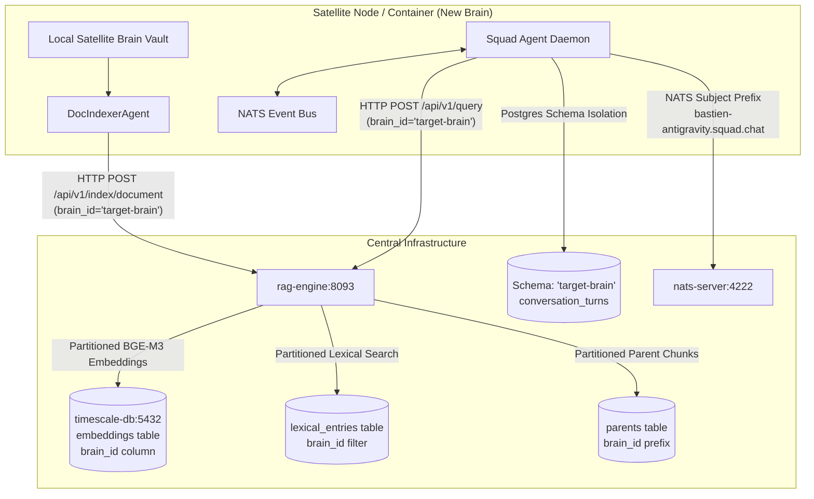
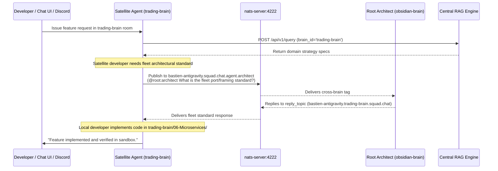

# 🧠 Multi-Brain Partitioning and Distributed Squad Standard

This document defines the authoritative architecture for multi-tenant brain partitioning, containerized squad agent deployment, zero-hardcoded dynamic discovery, and clean state separation across the Bastien-Antigravity ecosystem.

---

## 1. Architectural Mission & Option A Design

The ecosystem employs a **Centralized Multi-Tenant Partitioning Architecture (Option A)**. All knowledge embeddings, conversational memories, and agent communications converge onto central infrastructure instances while maintaining strict cryptographic and namespace isolation:



### Key Architectural Invariants:
1. **Lightweight Satellite Brains**: Satellite brains do not require PyTorch, CUDA, or local LLMs. Central `rag-engine` computes high-dimensional BGE-M3 embeddings.
2. **Deterministic Partitioning (`brain_id`)**: Every chunk and embedding is stamped with `brain_id`. Queries strictly filter on `brain_id` unless multi-vault federation is explicitly requested.
3. **Atomic Clean Unmerge**: Purging a brain deletes its vectors, lexical entries, and parent records in a single coordinated operation with zero residual state.
4. **Zero Silent Fallback**: Hardcoding IP addresses (e.g. `127.0.0.1`), ports (e.g. `8093`), or default brain names (`obsidian-brain`) is strictly prohibited. All networking resolves dynamically through `microservice-toolbox` (`get_rest_addr`, `get_listen_addr`).

---

## 2. Dynamic Discovery & Zero-Hardcoded Access

All inter-service and RAG communication MUST utilize dynamic capability resolution. Hardcoding fallback hosts or ports in microservice code violates ecosystem standards (`ZERO_SILENT_FALLBACK`).

### Canonical Dynamic Address Access
```python
# Correct Pattern in Python:
rag_addr = app_config.get_rest_addr("rag_engine")  # e.g. "rag-engine:8093" or "127.0.0.1:8093"
url = f"http://{rag_addr}/api/v1/query"

# Correct Pattern in Go:
ragAddr := appConfig.GetRESTAddr("rag_engine")
```

If the capability or required port cannot be resolved from configuration or service discovery, the component must fail-fast with an informative error rather than silently defaulting to loopback ports.

### Dynamic Brain Identifier Resolution
Microservices and squad agents resolve their active partition namespace dynamically:
1. `TARGET_BRAIN_ID` or `BRAIN_ID` environment variable.
2. `capabilities.squad_agent.target_brain_id` in YAML configuration.
3. Explicit runtime invocation parameter.

Omitting `brain_id` in document indexing or unmerging immediately raises a `400 Bad Request` or `ValueError` to prevent unintentional pollution of root vaults.

---

## 3. Clean Merge & Atomic Unmerge Protocol

### Ingesting / Merging a Brain
When indexing documents from a satellite brain or local directory:
1. `DocIndexerAgent.scan_and_index_local_vault(brain_id, local_vault_dir)` reads local Markdown notes.
2. Sends chunks to `POST /api/v1/index/document` with `brain_id`.
3. Central `rag-engine` embeds text via BGE-M3, constructs hierarchical headers, and stores records tagged with `brain_id`.

### Purging / Unmerging a Brain
To completely unmerge and remove a satellite brain from the ecosystem with zero state leakage:
1. `DocIndexerAgent.purge_brain_index(brain_id)` sends `POST /api/v1/vault/purge`.
2. `RAGFacade.delete_by_brain(brain_id)` performs atomic deletion across all storage layers:
   - **Vector Store**: `DELETE FROM embeddings WHERE brain_id = %s OR metadata->>'brain_id' = %s`
   - **Lexical Store**: `DELETE FROM lexical_entries WHERE id LIKE %s OR metadata->>'brain_id' = %s`
   - **Parent Store**: `DELETE FROM parents WHERE id LIKE %s`
3. **Root Brain Protection**: Purging `brain_id = 'obsidian-brain'` is strictly restricted via remote agent tools to prevent ecosystem data loss.

---

## 4. Containerized Squad Agent Deployment

To run a squad agent workshop for a new brain inside Docker:

### Docker Compose Profile Integration
```yaml
  # --- AI Squad Agent Workshop for Satellite Brain ---
  squad-agent-satellite:
    image: ghcr.io/bastien-antigravity/squad-agent-brain:${TAG:-latest}
    container_name: squad-agent-${BRAIN_ID:-satellite-brain}
    restart: unless-stopped
    ports:
      - "${HOST_IP:-127.0.0.1}:${SA_PORT:-8095}:8085"
      - "${HOST_IP:-127.0.0.1}:${SA_GRPC_PORT:-8097}:8087"
    environment:
      - BRAIN_ID=${BRAIN_ID:-satellite-brain}
      - TARGET_BRAIN_ID=${BRAIN_ID:-satellite-brain}
      - SA_PORT=8085
      - SA_GRPC_PORT=8087
      - DISCORD_BOT_TOKEN=${DISCORD_BOT_TOKEN:-}
      - DISCORD_CHANNEL_ID=${DISCORD_CHANNEL_ID:-}
    volumes:
      - ../:/app/brain:rw
      - ./standalone.yaml:/app/standalone.yaml:ro
    networks:
      - teleremote-network
```

### Automatic Ecosystem Integration & Filesystem Invariants
When a satellite brain container launches:
1. **Container Filesystem Boundary Invariant**:
   - Each satellite brain is an autonomous, self-contained unit.
   - Its local microservices and domain code live strictly inside `/app/brain/06-Microservices/<service-name>/`.
   - Its local BDD specifications live strictly inside `/app/brain/02-Business-BDD/02-Behavior-Specs/<service-name>/`.
   - Central agents in `obsidian-brain` **never perform cross-container disk I/O**. All coding, compiling (`go build`, `cargo check`, `pytest`), and test execution for a satellite brain are handled by that satellite brain's **local developer and QA agents**.
2. **Network-Only Push RAG Indexing**:
   - Central `rag-engine` never mounts or reads satellite disk files.
   - The satellite's local `DocIndexerAgent` scans its local `/app/brain/` markdown files and pushes chunks over HTTP REST: `POST http://rag-engine:8093/api/v1/index/document` with `brain_id`.
   - Central `rag-engine` indexes the embeddings into PostgreSQL with `brain_id = 'satellite-brain'`.
3. **Database Schema & Vector Partitioning**:
   - Conversational state binds to PostgreSQL schema `08-Squad-Agent` with `brain_id = 'satellite-brain'` partition filter.
4. **Dynamic NATS Messaging & Zero Crosstalk**:
   - Auto-subscribes to isolated topic `bastien-antigravity.{brain_id}.squad.chat`.
5. **Real-Time Discord Channel Mirroring**:
   - `discord-client` mirrors squad events live into a designated Discord channel with role avatars (🤖 Orchestrator, 🛠️ Developer, 🧪 QA, 📐 Architect, 📈 Trader) and forwards user prompts over NATS.

---

## 5. Inter-Agent & Cross-Brain Communication



### Addressing Rules & Tag Routing:
1. **Intra-Brain Chat (`@role`)**:
   - Plain tags like `@developer`, `@orchestrator`, `@trader` remain strictly inside the local brain room `bastien-antigravity.{brain_id}.squad.chat`. Zero crosstalk leaks into the root room.
2. **Cross-Brain Delegation (`@{target_brain}:{role}`)**:
   - Compound tags route across brain rooms:
     - `@root:developer` or `@obsidian-brain:developer`: Satellite agent delegates engineering tasks to the central root developer.
     - `@root:architect`: Satellite agent queries central fleet architecture standards.
     - `@trading-brain:trader`: Root developer asks the satellite domain expert for business rule clarification.
   - The message payload carries `source_brain_id` and `reply_topic`, guaranteeing responses route directly back to the originating brain room.

