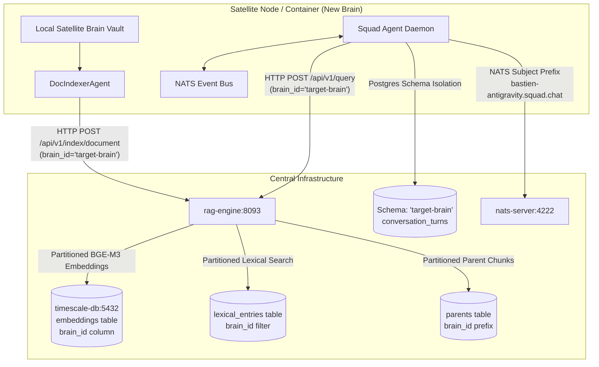
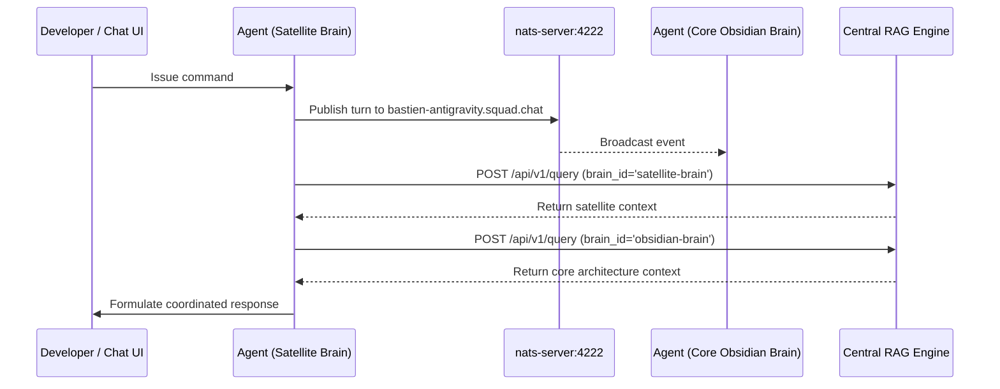

# 🧠 Multi-Brain Partitioning and Distributed Squad Standard

This document defines the authoritative architecture for multi-tenant brain partitioning, containerized squad agent deployment, zero-hardcoded dynamic discovery, and clean state separation across the Bastien-Antigravity ecosystem.

---

## 1. Architectural Mission & Option A Design

The ecosystem employs a **Centralized Multi-Tenant Partitioning Architecture (Option A)**. All knowledge embeddings, conversational memories, and agent communications converge onto central infrastructure instances while maintaining strict cryptographic and namespace isolation:



### Key Architectural Invariants:
1. **Lightweight Satellite Brains**: Satellite brains do not require PyTorch, CUDA, or local LLMs. Central `rag-engine` computes high-dimensional BGE-M3 embeddings.
2. **Deterministic Partitioning (`brain_id`)**: Every chunk and embedding is stamped with `brain_id`. Queries strictly filter on `brain_id` unless multi-vault federation is explicitly requested.
3. **Atomic Clean Unmerge**: Purging a brain deletes its vectors, lexical entries, and parent records in a single coordinated operation with zero residual state.
4. **Zero Silent Fallback**: Hardcoding IP addresses (e.g. `127.0.0.1`), ports (e.g. `8093`), or default brain names (`obsidian-brain`) is strictly prohibited. All networking resolves dynamically through `microservice-toolbox` (`get_rest_addr`, `get_listen_addr`).

---

## 2. Dynamic Discovery & Zero-Hardcoded Access

All inter-service and RAG communication MUST utilize dynamic capability resolution. Hardcoding fallback hosts or ports in microservice code violates ecosystem standards (`ZERO_SILENT_FALLBACK`).

### Canonical Dynamic Address Access
```python
# Correct Pattern in Python:
rag_addr = app_config.get_rest_addr("rag_engine")  # e.g. "rag-engine:8093" or "127.0.0.1:8093"
url = f"http://{rag_addr}/api/v1/query"

# Correct Pattern in Go:
ragAddr := appConfig.GetRESTAddr("rag_engine")
```

If the capability or required port cannot be resolved from configuration or service discovery, the component must fail-fast with an informative error rather than silently defaulting to loopback ports.

### Dynamic Brain Identifier Resolution
Microservices and squad agents resolve their active partition namespace dynamically:
1. `TARGET_BRAIN_ID` or `BRAIN_ID` environment variable.
2. `capabilities.squad_agent.target_brain_id` in YAML configuration.
3. Explicit runtime invocation parameter.

Omitting `brain_id` in document indexing or unmerging immediately raises a `400 Bad Request` or `ValueError` to prevent unintentional pollution of root vaults.

---

## 3. Clean Merge & Atomic Unmerge Protocol

### Ingesting / Merging a Brain
When indexing documents from a satellite brain or local directory:
1. `DocIndexerAgent.scan_and_index_local_vault(brain_id, local_vault_dir)` reads local Markdown notes.
2. Sends chunks to `POST /api/v1/index/document` with `brain_id`.
3. Central `rag-engine` embeds text via BGE-M3, constructs hierarchical headers, and stores records tagged with `brain_id`.

### Purging / Unmerging a Brain
To completely unmerge and remove a satellite brain from the ecosystem with zero state leakage:
1. `DocIndexerAgent.purge_brain_index(brain_id)` sends `POST /api/v1/vault/purge`.
2. `RAGFacade.delete_by_brain(brain_id)` performs atomic deletion across all storage layers:
   - **Vector Store**: `DELETE FROM embeddings WHERE brain_id = %s OR metadata->>'brain_id' = %s`
   - **Lexical Store**: `DELETE FROM lexical_entries WHERE id LIKE %s OR metadata->>'brain_id' = %s`
   - **Parent Store**: `DELETE FROM parents WHERE id LIKE %s`
3. **Root Brain Protection**: Purging `brain_id = 'obsidian-brain'` is strictly restricted via remote agent tools to prevent ecosystem data loss.

---

## 4. Containerized Squad Agent Deployment

To run a squad agent workshop for a new brain inside Docker:

### Docker Compose Profile Integration
```yaml
  # --- AI Squad Agent Workshop for Satellite Brain ---
  squad-agent-satellite:
    image: ghcr.io/bastien-antigravity/squad-agent:develop
    container_name: squad-agent-satellite
    restart: unless-stopped
    profiles: [ "squad", "all" ]
    depends_on:
      timescale-db: { condition: service_healthy }
      nats-server: { condition: service_healthy }
    environment:
      - DOCKER_ENV=true
      - TARGET_BRAIN_ID=satellite-brain
      - NATS_IP=nats-server
      - NATS_PORT=4222
      - TS_IP=timescale-db
      - TS_PORT=5432
      - TS_DBNAME=obsidiandb
      - RG_IP=rag-engine
      - RG_REST_PORT=8093
      - BASTIEN_PRIVATE_KEY_PATH=/etc/bastien/private.pem
    volumes:
      - /path/to/satellite-brain:/workspace/satellite-brain:rw
      - ./modes/docker/config/services/squad-agent.yaml:/app/standalone.yaml:ro
      - /etc/bastien/private.pem:/etc/bastien/private.pem:ro
    networks:
      - teleremote-network
```

### Automatic Ecosystem Integration
When the container launches:
1. **Database Isolation**: Auto-creates and binds to PostgreSQL schema `satellite-brain` inside `obsidiandb`.
2. **NATS Messaging**: Auto-subscribes to `bastien-antigravity.squad.chat`.
3. **RAG Access**: Auto-targets `satellite-brain` partition while retaining capability to federate with `obsidian-brain`.
4. **Log Aggregation**: Connects to `log-server:9020` over SafeSocket TCP.

---

## 5. Inter-Agent & Cross-Brain Communication



1. **Intra-Brain**: Agents inside the same brain communicate over NATS pub/sub on `bastien-antigravity.squad.chat` filtered by `session_id`.
2. **Cross-Brain**: Agents across different brains can query each other's knowledge partitions through central RAG, or exchange messages across brain-specific NATS subjects.
