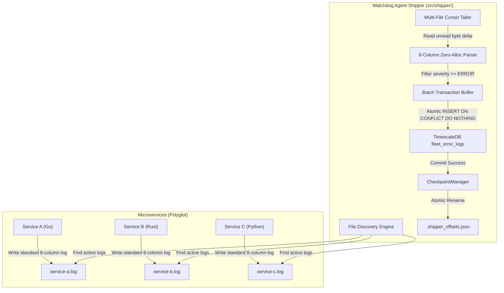
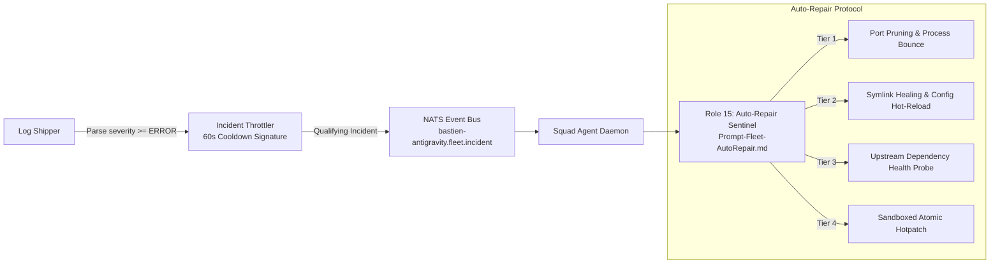

# 16. Fleet Error Log Persistence & Shipping Standard

## 1. Executive Summary & Core Objective

In the Bastien-Antigravity ecosystem, microservices generate high-frequency logs (trace, debug, info, warn, error). While debug and informational logs are streamed in real time to `log-server` via Cap'n Proto / gRPC for ephemeral ring-buffering and file-system inspection, operational incidents with severity **`level >= ERROR`** require long-term, indexed persistence in a queryable relational database.

Direct synchronous database logging from individual microservices is strictly prohibited:
1. It introduces network latency and database connection overhead into high-speed execution loops.
2. If the database crashes or becomes unreachable, microservices would either block, crash, or drop error messages silently.
3. Microservices written in polyglot runtimes (Go, Rust, Python, C++, Node.js) would each require heavy database drivers and connection pooling logic.

To guarantee **zero-loss durability**, **minimal resource overhead**, and **architectural decoupling**, error logging is handled via an asynchronous file-tailing architecture orchestrated by the **Autonomous Fleet Error Log Shipper** embedded within `watchdog-agent`.

---

## 2. Architecture & Data Flow Overview



---

## 3. Dual Deployment Modes: Native vs. Docker Containerized

The shipper seamlessly adapts between native operating systems and Docker containerized stacks without requiring different code or complex configurations:

### Mode A: Native Local Host Mode
- The `watchdog-agent` process runs as the local host supervisor.
- The shipper scans the workspace directory tree for `*/logs/*.log` files (excluding `.git`, `node_modules`, `target`, and `vendor`).
- Offsets are recorded in `.shipper_offsets.json` in the root workspace or designated cache folder.

### Mode B: Docker Stacks (Shared Log Volume)
- Instead of running a heavyweight watchdog process inside every single application container, all containerized microservices mount a shared Docker volume:
  ```yaml
  volumes:
    fleet-logs:
  ```
- Each microservice container writes to its mounted directory:
  ```yaml
  volumes:
    - fleet-logs:/var/log/fleet/log-server
  ```
- A single lightweight container `log-shipper` runs the `watchdog-agent` binary in shipper mode, mounting `fleet-logs:/var/log/fleet:ro` in read-only mode and persistent `shipper-state:/state`.
- **Resource Footprint**: Minimal overhead (1 single container for the entire node, rather than $N$ sidecars).

### Orchestrator Decoupling & Capability Switches
To prevent conflicts between the host supervisor and container runtimes (such as Docker daemon or Kubernetes), `watchdog-agent` decouples its capabilities via explicit switches:
- `--mode=shipper` (or `DOCKER_ENV=true`): Automatically disables process supervision, binary compilation, and port pruning (`supervise: false`). The agent acts strictly as an asynchronous log shipper.
- `--mode=supervisor`: Dedicated native process supervisor (spawns child processes, monitors TCP dependencies, restarts crashed binaries).
- `--mode=all` (default native): Full suite including supervisor, log shipper, and REST dashboard.
- In Docker environments, service crashes and restarts are managed exclusively by Docker (`restart: unless-stopped`), ensuring zero race conditions with `watchdog-agent`.

---

## 4. Standard 8-Column Log Format & Zero-Allocation Parser

All microservices write logs formatted according to the standard ecosystem fixed-width 8-column format:

```text
timestamp(33) host(12) logger(22) level(10) file(20) func(25) line(6) message
```

Example:
```text
2026-11-09T14:15:00.000000000Z    node-01      config-server          ERROR      main.go              Bootstrap                 42     Failed to load database config
```

### Parser Characteristics:
- **Zero Heap Allocation**: Parses fixed column indices directly via byte slicing (`strings.TrimSpace(line[34:46])`), eliminating GC pressure during heavy log processing.
- **Severity Normalization**: Checks whether the extracted level meets or exceeds `ERROR`:
  - Qualifying levels: `ERROR`, `CRIT`, `CRITICAL`, `ALERT`, `EMERG`, `FATAL`, `PANIC`.
  - Discarded levels: `DEBUG`, `TRACE`, `INFO`, `NOTICE`, `WARN`, `WARNING`.
- **Regex Fallback**: Non-standard log lines (e.g. multi-line stack traces or legacy formats) fall back to a compiled regex extractor.

---

## 5. Checkpoint Integrity & Fault-Tolerance Invariants

To guarantee that no errors are lost during crashes, restarts, log file rotations, or database downtime, the shipper enforces four critical invariants:

### 1. Inode & Size Rotation Detection
Filesystem logs periodically rotate or truncate. The `CheckpointManager` records both the byte offset and the OS file inode (`syscall.Stat_t.Ino` on POSIX):
- If `currentFileSize < lastCommittedOffset`, the log was truncated $\rightarrow$ reset cursor to `0`.
- If `currentInode != lastCommittedInode`, the file was renamed/rotated $\rightarrow$ reset cursor to `0`.

### 2. Transactional Commit-Gated Checkpointing
Offsets are **never** incremented or saved before the database write succeeds:
1. Read unread bytes from log files.
2. Filter error entries into a batch.
3. Open database transaction `tx, err := db.BeginTx(...)`.
4. Execute `INSERT INTO fleet_error_logs (...) VALUES (...)`.
5. Call `tx.Commit()`.
6. Only upon `tx.Commit()` success, update in-memory file offsets and write `.shipper_offsets.json`.

### 3. Checkpoint Freezing on Database Downtime
If TimescaleDB is offline or fails during insertion:
- The transaction rolls back.
- Offsets remain frozen at their last known good state.
- The shipper backs off for 5 seconds before attempting reconnection.
- When the database recovers, all uncommitted error logs are parsed and shipped with zero loss.

### 4. Atomic File Persistence
The `.shipper_offsets.json` file is written to `.shipper_offsets.json.tmp` and replaced using an atomic OS filesystem rename (`os.Rename`), preventing state file corruption during abrupt shutdowns.

---

## 6. TimescaleDB Hypertable Schema & Startup Verification

The error logs are stored in a partitioned TimescaleDB hypertable configured declaratively in `02-fleet-error-logs.sql` and verified automatically at startup by the shipper (`EnsureSchema`):

```sql
CREATE TABLE IF NOT EXISTS fleet_error_logs (
    timestamp     TIMESTAMPTZ NOT NULL,
    hostname      VARCHAR(64) NOT NULL,
    service_name  VARCHAR(64) NOT NULL,
    logger_name   VARCHAR(64) NOT NULL,
    level         SMALLINT NOT NULL,          -- 10 = ERROR, 11 = CRITICAL
    level_str     VARCHAR(16) NOT NULL,
    filename      VARCHAR(256),
    function_name VARCHAR(128),
    line_number   VARCHAR(16),
    message       TEXT NOT NULL,
    stack_trace   TEXT,
    created_at    TIMESTAMPTZ NOT NULL DEFAULT NOW()
);

-- Convert to TimescaleDB Hypertable partitioned by timestamp (1-day chunks)
DO $$ BEGIN
    IF EXISTS (SELECT 1 FROM pg_extension WHERE extname = 'timescaledb') THEN
        PERFORM create_hypertable('fleet_error_logs', 'timestamp', chunk_time_interval => INTERVAL '1 day', if_not_exists => TRUE);
    END IF;
EXCEPTION WHEN OTHERS THEN
    NULL;
END $$;

-- Compound Indexes for real-time querying & telemetry
CREATE INDEX IF NOT EXISTS idx_fleet_error_svc_time 
    ON fleet_error_logs (service_name, timestamp DESC);

CREATE INDEX IF NOT EXISTS idx_fleet_error_level_time 
    ON fleet_error_logs (level, timestamp DESC);
```

---

## 7. Real-Time Squad Agent Forwarding & Autonomous Auto-Repair

In addition to batch database storage, the error shipping architecture enables **real-time AI self-healing**:



### Safety Guarantees:
1. **Incident Throttling & Deduplication**: High-frequency recurring errors are rate-limited to 1 alert per 60 seconds per `(service:file:line)` signature with an accumulated occurrence counter, preventing AI prompt flooding.
2. **Minimal Blast Radius**: Auto-repair actions are governed by [[Prompt-Fleet-AutoRepair.md]], enforcing read-only triage, git restore checkpoints before patching, mandatory unit test verification, and a 3-strike circuit breaker against infinite restart loops.


