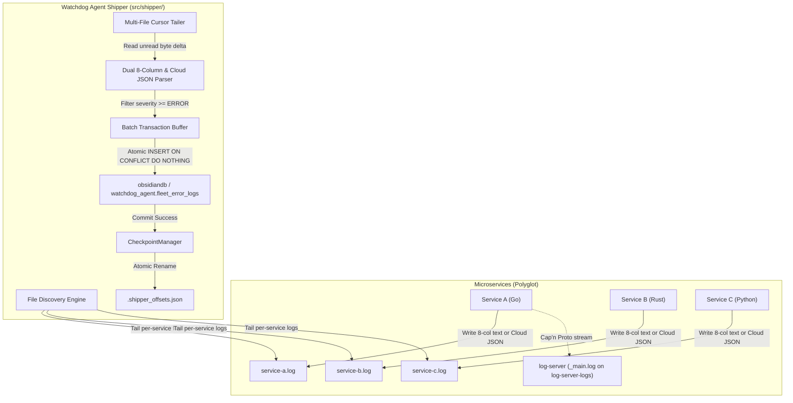
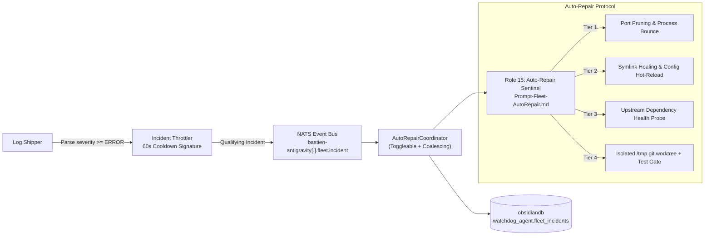

# 16. Fleet Error Log Persistence & Shipping Standard

## 1. Executive Summary & Core Objective

In the Bastien-Antigravity ecosystem, microservices generate high-frequency logs across the 11 canonical active severity/domain levels defined in `flexible-logger/src/models/level.go` (`DEBUG`, `STREAM`, `INFO`, `LOGON`, `LOGOUT`, `TRADE`, `SCHEDULE`, `REPORT`, `WARNING`, `ERROR`, `CRITICAL`). While telemetry and informational logs are streamed in real time to `log-server` via Cap'n Proto / gRPC for ephemeral ring-buffering and file-system inspection, operational incidents with severity **`level >= ERROR`** (`ERROR` = 10, `CRITICAL` = 11) require long-term, indexed persistence in a queryable relational database.

Direct synchronous database logging from individual microservices is strictly prohibited:
1. It introduces network latency and database connection overhead into high-speed execution loops.
2. If the database crashes or becomes unreachable, microservices would either block, crash, or drop error messages silently.
3. Microservices written in polyglot runtimes (Go, Rust, Python, C++, Node.js) would each require heavy database drivers and connection pooling logic.

To guarantee **zero-loss durability**, **minimal resource overhead**, and **architectural decoupling**, error logging is handled via an asynchronous file-tailing architecture orchestrated by the **Autonomous Fleet Error Log Shipper** embedded within `watchdog-agent`.

---

## 2. Architecture & Data Flow Overview



### Why Microservice Logs Do Not Duplicate `log-server`
- Microservices write both to their own `.log` file (`*/logs/*.log` natively, or `/var/log/fleet/<service>/<service>.log` in Docker) and over the network to `log-server` (`_main.log`).
- **`watchdog-agent` tails each microservice's own log file directly**, not the aggregated stream in `log-server`:
  - **Docker Mode**: Services mount shared `fleet-logs:/var/log/fleet/<service>` (read by `log-shipper` via `fleet-logs:/var/log/fleet:ro`), whereas `log-server` writes `_main.log` to an isolated `log-server-logs:/var/log/log-server` volume (`LOG_DIR` + `DOCKER_ENV=true`).
  - **Native Mode**: `DiscoverFiles` skips forwarded non-`log_server` lines inside `_main.log` (`isAggregatedMainLog` + `isOwnLogServerEntry`), preserving only `log_server`'s own internal errors while preventing double-shipping of sibling services.

---

## 3. Dual Deployment Modes: Native vs. Docker Containerized

The shipper seamlessly adapts between native operating systems and Docker containerized stacks without requiring different code or complex configurations:

### Mode A: Native Local Host Mode
- The `watchdog-agent` process runs as the local host supervisor.
- The shipper scans the workspace directory tree for `*/logs/*.log` files (excluding `.git`, `node_modules`, `target`, and `vendor`).
- Offsets are recorded in `.shipper_offsets.json` in the root workspace or designated cache folder.

### Mode B: Docker Stacks (Shared Log Volume)
- Instead of running a heavyweight watchdog process inside every single application container, all containerized microservices mount a shared Docker volume:
  ```yaml
  volumes:
    fleet-logs:
  ```
- Each microservice container writes to its mounted directory:
  ```yaml
  volumes:
    - fleet-logs:/var/log/fleet/log-server
  ```
- A single lightweight container `log-shipper` runs the `watchdog-agent` binary in shipper mode, mounting `fleet-logs:/var/log/fleet:ro` in read-only mode and persistent `shipper-state:/state`.
- **Resource Footprint**: Minimal overhead (1 single container for the entire node, rather than $N$ sidecars).

### Orchestrator Decoupling & Capability Switches
To prevent conflicts between the host supervisor and container runtimes (such as Docker daemon or Kubernetes), `watchdog-agent` decouples its capabilities via explicit switches:
- `--mode=shipper` (or `DOCKER_ENV=true`): Automatically disables process supervision, binary compilation, and port pruning (`supervise: false`). The agent acts strictly as an asynchronous log shipper.
- `--mode=supervisor`: Dedicated native process supervisor (spawns child processes, monitors TCP dependencies, restarts crashed binaries).
- `--mode=all` (default native): Full suite including supervisor, log shipper, and REST dashboard.
- In Docker environments, service crashes and restarts are managed exclusively by Docker (`restart: unless-stopped`), ensuring zero race conditions with `watchdog-agent`.

---

## 4. Standard 8-Column & Cloud JSON Parser (`parser.go`)

Microservices write logs either in the standard fixed-width 8-column text format OR — when using the `cloud` / `cloud_native` profile (`flexible-logger/src/profiles/cloud_native.go`) — as structured JSON lines (`serializers.JSONSerializer`) written simultaneously to `stderr` (for container collectors) and to the local rolling file (`helpers.GetLogPath`):

```text
timestamp(33) host(12) logger(22) level(10) file(20) func(25) line(6) message
```

Example:
```text
2026-11-09T14:15:00.000000000Z    node-01      config-server          ERROR      main.go              Bootstrap                 42     Failed to load database config
```

### Parser Characteristics:
- **Zero-Alloc Text & Fast-Path JSON Routing**: Standard 8-column lines use byte slicing; lines starting with `{` enter `parseJSONLogLine`, which first checks `:10`, `:11`, `"ERROR"`, or `"CRITICAL"` before running `json.Unmarshal` so 99%+ of non-error JSON lines incur zero unmarshaling overhead.
- **Severity Normalization**: Strictly aligned with `flexible-logger/src/models/level.go` (source of truth) and `watchdog-agent/src/shipper/parser.go`, checks whether the extracted level meets or exceeds `ERROR` (`level >= 10`):
  - Qualifying levels: `ERROR` (`10`), `CRITICAL` (`11`).
  - Discarded levels: `DEBUG` (`1`), `STREAM` (`2`), `INFO` (`3`), `LOGON` (`4`), `LOGOUT` (`5`), `TRADE` (`6`), `SCHEDULE` (`7`), `REPORT` (`8`), `WARNING` (`9`).
- **Regex & Poison-Pill Safety**: Variably-spaced text lines fall back to `fallbackLogRegex`, and `sanitizeLogText` repairs invalid UTF-8 and strips NUL bytes before database serialization.

---

## 5. Checkpoint Integrity & Fault-Tolerance Invariants

To guarantee that no errors are lost during crashes, restarts, log file rotations, or database downtime, the shipper enforces four critical invariants:

### 1. Inode & Size Rotation Detection
Filesystem logs periodically rotate or truncate. The `CheckpointManager` records both the byte offset and the OS file inode (`syscall.Stat_t.Ino` on POSIX):
- If `currentFileSize < lastCommittedOffset`, the log was truncated $\rightarrow$ reset cursor to `0`.
- If `currentInode != lastCommittedInode`, the file was renamed/rotated $\rightarrow$ reset cursor to `0`.

### 2. Transactional Commit-Gated Checkpointing
Offsets are **never** incremented or saved before the database write succeeds:
1. Read unread bytes from log files.
2. Filter error entries into a batch.
3. Open database transaction `tx, err := db.BeginTx(...)`.
4. Execute `INSERT INTO fleet_error_logs (...) VALUES (...)`.
5. Call `tx.Commit()`.
6. Only upon `tx.Commit()` success, update in-memory file offsets and write `.shipper_offsets.json`.

### 3. Checkpoint Freezing on Database Downtime
If TimescaleDB is offline or fails during insertion:
- The transaction rolls back.
- Offsets remain frozen at their last known good state.
- The shipper backs off for 5 seconds before attempting reconnection.
- When the database recovers, all uncommitted error logs are parsed and shipped with zero loss.

### 4. Atomic File Persistence
The `.shipper_offsets.json` file is written to `.shipper_offsets.json.tmp` and replaced using an atomic OS filesystem rename (`os.Rename`), preventing state file corruption during abrupt shutdowns.

---

## 6. Option B TimescaleDB Schema (`obsidiandb`) & Startup Verification

Error telemetry and AutoRepair incident state live inside the base ecosystem database **`obsidiandb`** under dedicated schema **`watchdog_agent`**, initialized declaratively in `02-fleet-error-logs.sql` and verified idempotently at startup by both `watchdog-agent` (`EnsureSchema`) and `08-Squad-Agent` (`ensure_fleet_error_schema`):

```sql
CREATE SCHEMA IF NOT EXISTS watchdog_agent;

CREATE TABLE IF NOT EXISTS watchdog_agent.fleet_error_logs (
    timestamp     TIMESTAMPTZ NOT NULL,
    brain_id      VARCHAR(64) NOT NULL,
    hostname      VARCHAR(64) NOT NULL,
    service_name  VARCHAR(64) NOT NULL,
    logger_name   VARCHAR(64) NOT NULL,
    level         SMALLINT NOT NULL,          -- 10 = ERROR, 11 = CRITICAL
    level_str     VARCHAR(16) NOT NULL,
    filename      VARCHAR(256),
    function_name VARCHAR(128),
    line_number   VARCHAR(16),
    message       TEXT NOT NULL,
    stack_trace   TEXT,
    event_hash    VARCHAR(64) NOT NULL,
    created_at    TIMESTAMPTZ NOT NULL DEFAULT NOW()
);

-- Convert to TimescaleDB Hypertable partitioned by timestamp (1-day chunks)
DO $$ BEGIN
    IF EXISTS (SELECT 1 FROM pg_extension WHERE extname = 'timescaledb') THEN
        PERFORM create_hypertable('watchdog_agent.fleet_error_logs', 'timestamp', chunk_time_interval => INTERVAL '1 day', if_not_exists => TRUE);
    END IF;
EXCEPTION WHEN OTHERS THEN
    NULL;
END $$;

CREATE UNIQUE INDEX IF NOT EXISTS uq_watchdog_fleet_error_event_hash_ts
    ON watchdog_agent.fleet_error_logs (event_hash, timestamp);

CREATE INDEX IF NOT EXISTS idx_watchdog_fleet_error_brain_svc_time
    ON watchdog_agent.fleet_error_logs (brain_id, service_name, timestamp DESC);

CREATE INDEX IF NOT EXISTS idx_watchdog_fleet_error_level_time
    ON watchdog_agent.fleet_error_logs (level, timestamp DESC);

CREATE TABLE IF NOT EXISTS watchdog_agent.fleet_incidents (
    incident_id         VARCHAR(64) PRIMARY KEY,
    brain_id            VARCHAR(64) NOT NULL,
    event_hash          VARCHAR(64),
    service_name        VARCHAR(64) NOT NULL,
    hostname            VARCHAR(64),
    level_str           VARCHAR(16) NOT NULL,
    tier                SMALLINT NOT NULL DEFAULT 4,
    status              VARCHAR(32) NOT NULL DEFAULT 'AWAITING_APPROVAL',
    filename            VARCHAR(256),
    line_number         VARCHAR(16),
    message             TEXT NOT NULL,
    root_cause          TEXT,
    proposed_patch      TEXT,
    target_relpath      VARCHAR(512),
    verification_output TEXT,
    action_taken        TEXT,
    occurrence_count    INTEGER NOT NULL DEFAULT 1,
    created_at          TIMESTAMPTZ NOT NULL DEFAULT NOW(),
    updated_at          TIMESTAMPTZ NOT NULL DEFAULT NOW()
);
```

> **Note on `event_hash` vs Log Occurrences**: `ComputeEventHash` hashes `brain_id | filePath | lineOffset | host | service | timestampNs | msg`. Every distinct error occurrence gets its own indexed row in `fleet_error_logs` (preserving accurate frequency/burst counts), while `ON CONFLICT (event_hash, timestamp) DO NOTHING` guarantees zero duplicate rows when crashes or DB outages replay uncommitted byte offsets.

---

## 7. Real-Time Squad Agent Forwarding, Toggle Control & Autonomous Auto-Repair

In addition to batch database storage, the error shipping architecture enables **real-time AI self-healing** via `AutoRepairCoordinator` (`08-Squad-Agent/src/agents/autorepair.py`):



### Multi-Layer Deduplication & Safety Guarantees:
1. **4-Stage Deduplication & Throttling**:
   - **Shipper DB Replay Idempotency**: `ComputeEventHash` + `ON CONFLICT DO NOTHING` prevents replay duplicates on DB reconnect.
   - **NATS Incident Throttler**: Emits at most 1 NATS alert per 60s per `(brain_id:service:file:line:level)` signature with an accumulated `occurrence_count`.
   - **Squad Agent Event & Signature Coalescing**: Bounded FIFO `event_hash` dedupe plus open-signature coalescing merges repeated alerts for an unacknowledged root cause into the existing incident record without extra LLM calls or Telegram spam.
   - **3-Strike Circuit Breaker**: >3 repair/restart strikes within 120s freezes `(brain_id, service_name)` until cooldown or explicit `POST /api/v1/squad/autorepair/unfreeze`.
2. **Capability-Aware Execution & Worktree Gating**:
   - **Read-Only / Proposal Mode** (`proposal_only` in `:ro` containers): Computes RCA + patch proposal and waits for 1-click operator approval via Telegram (`🩺 AutoRepair` menu) or REST (`POST /api/v1/squad/incidents/{id}/approve|reject|resolve`).
   - **Verified Worktree Mode** (`verified_worktree`): Validates diff bounds and target containment (`validate_proposed_diff`), runs the service test suite inside an isolated `/tmp` `git worktree`, refuses to clobber dirty local files (`DIRTY_WORKTREE_BLOCKED`), creates a `restore-point/autorepair-...` tag, applies the patch, requests Watchdog restart, and logs to `AutoRepair-Log.md`.
3. **Configuration & On-the-Fly Enable / Disable Control**:
   - Configured at startup under `capabilities.squad_agent.autorepair.enabled` in `native.yaml` (or `squad_agent.autorepair.enabled` in Docker service slice `squad-agent.yaml`) via `${AUTO_REPAIR_ENABLED:-true}`, audited by Fleet Guard `param_inspector.py`, and hot-reloaded dynamically via `AppConfig.on_live_conf_update`.
   - `auto_apply` defaults to `false` at startup (approval-gated) and can only be enabled on the fly via the authenticated `POST /api/v1/squad/autorepair/toggle` REST endpoint (`GITHUB_TOKEN` required).
   - Controlled on the fly via Telegram `🩺 AutoRepair [ON/PAUSED]` toggle, or REST `GET /api/v1/squad/autorepair/status` & `POST /api/v1/squad/autorepair/toggle`. While paused, incoming NATS events are cleanly bypassed with zero LLM calls, alerts, or mutations.


